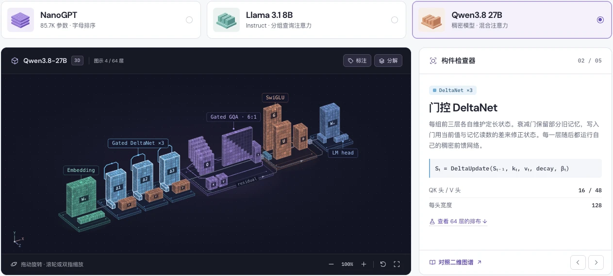

# Tensor Atlas · 语言模型解剖台

在浏览器里旋转和点选三维张量，查看每个构件的公式、真实尺寸和数据流。三个模型共用一套操作方式，可切换中英文。 [打开探索器](https://march-7.github.io/nano-llm-atlas/) · [English interface](https://march-7.github.io/nano-llm-atlas/?lang=en)

[](https://march-7.github.io/nano-llm-atlas/?model=qwen&stage=delta&lang=zh)

| 三维示例 | 可以探索什么 | Raschka 的二维对照 |
| --- | --- | --- |
| [NanoGPT](https://march-7.github.io/nano-llm-atlas/?model=nanogpt&stage=attention&lang=zh) | 展开三个解码块中的一个。用原演示权重逐字母排序，点选构件读取嵌入、归一化、三个头的注意力概率、GELU 激活和输出概率。 | [GPT-2 XL，同族架构](https://sebastianraschka.com/llm-architecture-gallery/models/gpt-2-xl-1-5b/) |
| [Llama-3.1-8B-Instruct](https://march-7.github.io/nano-llm-atlas/?model=llama&stage=attention&lang=zh) | 展开 32 个解码块中的一个，观察 RMSNorm、RoPE、GQA 和 SwiGLU。选择任意查询头，追踪它共享的键值头。 | [Llama 3 8B，同族架构](https://sebastianraschka.com/llm-architecture-gallery/models/llama-3-8b/) |
| [Qwen3.8-27B](https://march-7.github.io/nano-llm-atlas/?model=qwen&stage=delta&lang=zh) | 展开 16 个四层循环中的一组。前三层各含 Gated DeltaNet 和稠密 FFN，第四层含门控 GQA 和自己的 FFN。可以定位原语言主干的任一层。 | [Qwen3.8 27B，同一模型](https://sebastianraschka.com/llm-architecture-gallery/models/qwen3-8-27b/) |

这里的 nano 指压缩重复层、头和通道后的教学视图。模型规格保留原始尺寸。Llama 与 Qwen 展示结构和映射关系，Qwen 视图聚焦文本解码器。NanoGPT 的排序实验在本机执行完整的三层前向传播。

## 操作

- 拖动旋转，滚轮或双指缩放，Shift 加拖动可平移。支持切换标注、收拢构件和全屏查看。
- 点选张量或导览中的步骤，可同步查看说明。在 NanoGPT 实验中，输入六个 A、B、C 字母，逐步生成排序结果并查看当前最后位置的实测张量。
- 聚焦三维视窗后，可以用方向键旋转、用 `+` 和 `−` 缩放、用 `0` 或 `Home` 复位。地址栏保留当前模型、构件和语言，复制链接即可分享。

## 本地运行与验证

仓库根目录直接提供静态站点。浏览器加载原生 JavaScript 模块，Canvas 2D 将三维世界坐标投影到画布，按需重绘。模型切换、数值实验和字体均由本站提供。

```sh
python3 -m http.server 8000
```

打开 [本地预览](http://localhost:8000/)。使用 Node.js 20 或更新版本可运行回归检查。

```sh
node --test
```

测试核对三种模型的场景与导览映射、PyTorch 参考样例的中间激活和输出概率，并穷举全部 729 种六字母输入的自回归排序结果。GitHub Pages 从 `main` 分支根目录发布。

## 来源

- 3D 交互受 Brendan Bycroft 的 LLM Visualization 启发。排序实验使用其 minGPT 演示的 85,728 参数训练权重，保留了上游 MIT 许可。本站另行实现了绘图和前向计算。[原版演示](https://bbycroft.net/llm) · [权重版本](https://github.com/bbycroft/llm-viz/blob/9da93742382f1bf36c020c38a1ace454e82c4490/public/gpt-nano-sort-model.json) · [权重许可](assets/gpt-nano-sort-LICENSE.txt)
- Llama 和 Qwen 的结构说明按对应模型的资料编写。Gallery 的 Llama 3 8B 图适合对照 GQA 与 SwiGLU，3.1 Instruct 的上下文长度以 Meta 资料为准。[Meta 模型卡](https://huggingface.co/meta-llama/Llama-3.1-8B-Instruct) · [Qwen 模型配置](https://huggingface.co/Qwen/Qwen3.8-27B/blob/main/config.json) · [Sebastian Raschka 的 Gallery](https://sebastianraschka.com/llm-architecture-gallery/)
- 本地字体使用 DM Sans 和 IBM Plex Mono。[DM Sans 许可](assets/fonts/DM-Sans-OFL.txt) · [IBM Plex Mono 许可](assets/fonts/IBM-Plex-Mono-OFL.txt)
