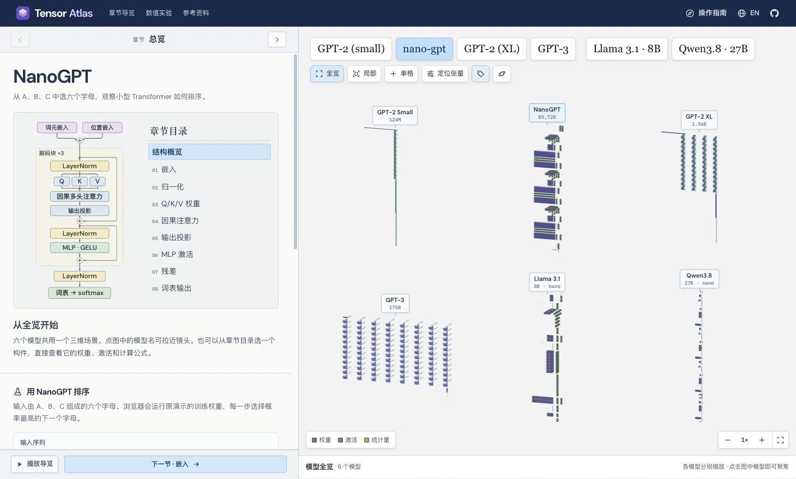

# Tensor Atlas · 语言模型三维计算图

打开首页即可在同一片三维画布中看到六个模型。桌面左栏给出模型流程图、章节目录、实验与来源；右栏可以从全览聚焦到整模、张量或单个权重。模型在总览中分别等比缩放，每个名称下都标出了原模型参数量。[打开六模型全览](https://march-7.github.io/nano-llm-atlas/?view=all&lang=zh) · [English](https://march-7.github.io/nano-llm-atlas/?view=all&lang=en)

[](https://march-7.github.io/nano-llm-atlas/?view=all&lang=zh)

点开 NanoGPT 的第二个 LayerNorm，可以逐格对照坐标、公式、数值与依赖。[进入 t=4, c=11](https://march-7.github.io/nano-llm-atlas/?model=nanogpt&tensor=ln2.lnResid&layer=1&x=4&y=11&lang=zh) · [查看单元截图](docs/nanogpt-cell.webp)

点击章节目录、流程图或「下一节」，画布会演示这一章的张量计算。例如 Llama 的 RMSNorm 从一个词元的输入列开始，逐通道累计平方和，计算逆 RMS，读取增益，最后把结果写回选中的单元。画布下方可以暂停、重播和拖动到任一步。「播放导览」会在本节计算结束后接着播下一节。系统开启减少动态效果时，可以手动逐步查看。[播放 Llama RMSNorm](https://march-7.github.io/nano-llm-atlas/?model=llama&lang=zh&stage=norm) · [观看实际操作录屏](https://march-7.github.io/nano-llm-atlas/docs/llama-rmsnorm.mp4)

## 六个模型

| 三维入口 | 展开范围 | 单元数据 |
| --- | --- | --- |
| [GPT-2 Small](https://march-7.github.io/nano-llm-atlas/?model=gpt2-small&view=network) | 12 层，每层 12 个头，2,294 个张量 | 公开检查点的实数权重可按需读取。激活展示公式与依赖。 |
| [NanoGPT](https://march-7.github.io/nano-llm-atlas/?model=nanogpt) | 全部 3 层，每层 3 个头，206 个张量 | 全部 85,728 个训练参数、本地前向传播的中间激活、归一化和 Softmax 统计量。 |
| [GPT-2 XL](https://march-7.github.io/nano-llm-atlas/?model=gpt2-xl&view=network) | 48 层，每层 25 个头，13,070 个张量 | 可定位每层每个头，在悬停时读取相应的真实权重。 |
| [GPT-3 175B](https://march-7.github.io/nano-llm-atlas/?model=gpt3&view=network) | 96 层，每层 96 个头，94,286 个张量 | 175B 检查点未公开，单元提供坐标、形状和符号公式。 |
| [Llama-3.1-8B-Instruct](https://march-7.github.io/nano-llm-atlas/?model=llama&stage=attention) | 展开一个代表层，保留 RMSNorm、RoPE、4∶1 的查询头与 KV 头分组、SwiGLU 和残差。 | 浏览器运行带固定教学权重的 32 维示例。原模型规格单列。[Gallery 的 Llama 3 8B 同族图](https://sebastianraschka.com/llm-architecture-gallery/models/llama-3-8b/) |
| [Qwen3.8-27B](https://march-7.github.io/nano-llm-atlas/?model=qwen&stage=delta) | 展开一个四层循环，含三个各自带 FFN 的 Gated DeltaNet 和一层带 FFN 的门控 GQA。 | 运行带固定教学权重的 40 维示例，可沿时间轴逐格查看递归状态。[Gallery 的同款二维图](https://sebastianraschka.com/llm-architecture-gallery/models/qwen3-8-27b/) · [门控 GQA 三维截图](docs/qwen-preview.webp) |

经典图保留 Bycroft 的分列与张量尺度。GPT-3 的参考图采用 1,024 个位置和统一因果注意力矩阵，论文配置为 2,048 个位置，并交替使用稠密与局部带状稀疏注意力。GPT-2 Small 与 NanoGPT 可用 Gallery 的 GPT-2 XL 图做同族对照。[GPT-3 论文 §2.1](https://arxiv.org/abs/2005.14165) · [GPT-2 XL 二维图](https://sebastianraschka.com/llm-architecture-gallery/models/gpt-2-xl-1-5b/)

## 从整网到一个标量

- **全览**把六个模型放入同一视野。点击图中的模型、名称标签或顶部的模型名，镜头会移到该模型。滚轮缩远即可重新看到相邻模型。左图和章节目录均可定位到右侧相应的张量。
- **按住鼠标滚轮（中键）并拖动**旋转观察方向。全览中六个模型共用竖直轴并保持各自的展位。左键拖动平移，滚动滚轮只改变缩放。[缩远后中键旋转的实测画面](docs/orbit-check.webp)
- 触屏支持双指缩放和旋转模式。手机上的**导览**可展开阅读区，同时保留画布。
- **局部**框选张量及其相邻构件，**单格**放大一个标量。悬停或点按会出现半透明的数值浮层。也可通过**定位张量**选择解码层、头与坐标，包含 Qwen 的递归状态时间切片。[示例：第 2 层 MLP 权重](https://march-7.github.io/nano-llm-atlas/?model=nanogpt&tensor=mlpFcWeight&layer=2&x=21&y=17&view=cell)
- 修改导览里的 A/B/C 输入或生成下一个字母，右侧 NanoGPT 的激活会同步更新。未来位置显示为尚未输入，因果掩码区分原始分数的 `−∞` 与 Softmax 后的 `0`。
- GPT-2 按需从 Hugging Face 的固定版本读取 Safetensors 索引和最多 4 KiB 的数据页。权重页保存在浏览器内存中。每次读取均校验 HTTP `206` 和 `Content-Range`。[Small 检查点版本](https://huggingface.co/openai-community/gpt2/tree/607a30d783dfa663caf39e06633721c8d4cfcd7e) · [XL 检查点版本](https://huggingface.co/openai-community/gpt2-xl/tree/15ea56dee5df4983c59b2538573817e1667135e2)

## 参考源码

经典模型几何改编自 Brendan Bycroft 的开源 LLM Visualization，并保留其 MIT 声明。本站将布局、三维投影与单元命中、数值读取和 HTML 公式浮层分开实现。按层复用几何模板、裁剪视口并依据缩放级别绘制网格，因此 GPT-3 的整模视图也能进入指定头的一格。[原站](https://bbycroft.net/llm) · [上游许可](assets/gpt-nano-sort-LICENSE.txt)

| 原站代码 | 对应功能 |
| --- | --- |
| [Program.ts](https://github.com/bbycroft/llm-viz/blob/9da93742382f1bf36c020c38a1ace454e82c4490/src/llm/Program.ts) · [ModelSelectorToolbar.tsx](https://github.com/bbycroft/llm-viz/blob/9da93742382f1bf36c020c38a1ace454e82c4490/src/llm/components/ModelSelectorToolbar.tsx) | 四种形状配置、镜头与模型切换顺序 |
| [GptModelLayout.ts](https://github.com/bbycroft/llm-viz/blob/9da93742382f1bf36c020c38a1ace454e82c4490/src/llm/GptModelLayout.ts) | 权重、偏置、中间激活与标量依赖的三维布局 |
| [Walkthrough03_LayerNorm.tsx](https://github.com/bbycroft/llm-viz/blob/9da93742382f1bf36c020c38a1ace454e82c4490/src/llm/walkthrough/Walkthrough03_LayerNorm.tsx) | 参考其抽出输入列、逐步聚合与写回的讲解方式。本站按各模型的算子和数值生成分步动画。 |
| [Interaction.ts](https://github.com/bbycroft/llm-viz/blob/9da93742382f1bf36c020c38a1ace454e82c4490/src/llm/Interaction.ts) · [DataFlow.ts](https://github.com/bbycroft/llm-viz/blob/9da93742382f1bf36c020c38a1ace454e82c4490/src/llm/components/DataFlow.ts) | 单元坐标、依赖行列、归一化和矩阵乘法公式 |

NanoGPT 使用原演示的训练权重。现代教学图的结构依据官方模型资料。字体随站点提供。[NanoGPT 权重](https://github.com/bbycroft/llm-viz/blob/9da93742382f1bf36c020c38a1ace454e82c4490/public/gpt-nano-sort-model.json) · [Meta 模型卡](https://huggingface.co/meta-llama/Llama-3.1-8B-Instruct) · [Qwen 配置](https://huggingface.co/Qwen/Qwen3.8-27B/blob/main/config.json) · [DM Sans 许可](assets/fonts/DM-Sans-OFL.txt) · [IBM Plex Mono 许可](assets/fonts/IBM-Plex-Mono-OFL.txt)

## 本地运行

在仓库根目录运行静态服务器后，打开 [本地预览](http://localhost:8000/)。GitHub Pages 从 `main` 根目录发布。

```sh
python3 -m http.server 8000
```

使用 Node.js 20 或更新版本运行回归测试，覆盖张量坐标、真实权重、逐层中间值、现代教学图的逐格运算和全部 729 种六字母排序输入。

```sh
node --test
```
